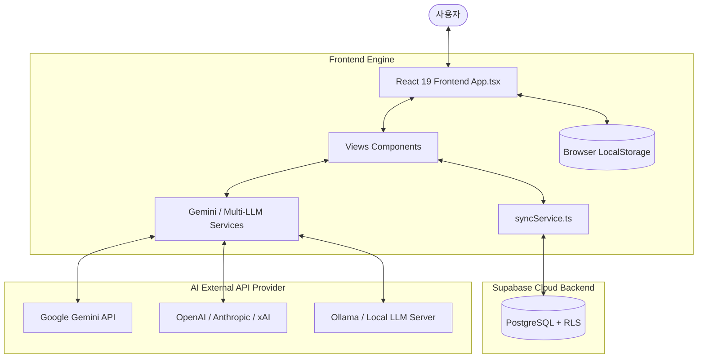

# 🧠 Dayflow LLM Wiki (Structured Knowledge Base)

Dayflow 프로젝트의 분석 문서가 체계적으로 **구조화된 모듈 폴더 [`llm_wiki/`](file:///C:/Users/%EC%B5%9C%EB%8F%99%EC%A4%80/Desktop/project/dayflow/llm_wiki/)** 로 정리되었습니다.

### 📚 Wiki 목차 이동
- **메인 목차 (Index)**: [`llm_wiki/INDEX.md`](file:///C:/Users/%EC%B5%9C%EB%8F%99%EC%A4%80/Desktop/project/dayflow/llm_wiki/INDEX.md)
- **아키텍처 및 디렉토리 맵**: [`llm_wiki/ARCHITECTURE.md`](file:///C:/Users/%EC%B5%9C%EB%8F%99%EC%A4%80/Desktop/project/dayflow/llm_wiki/ARCHITECTURE.md)
- **화면 및 UX 분석**: [`llm_wiki/VIEWS_AND_UX.md`](file:///C:/Users/%EC%B5%9C%EB%8F%99%EC%A4%80/Desktop/project/dayflow/llm_wiki/VIEWS_AND_UX.md)
- **AI 엔진 & 페르소나**: [`llm_wiki/AI_AND_PERSONA.md`](file:///C:/Users/%EC%B5%9C%EB%8F%99%EC%A4%80/Desktop/project/dayflow/llm_wiki/AI_AND_PERSONA.md)
- **데이터 모델 & 동기화**: [`llm_wiki/DATA_AND_SYNC.md`](file:///C:/Users/%EC%B5%9C%EB%8F%99%EC%A4%80/Desktop/project/dayflow/llm_wiki/DATA_AND_SYNC.md)
- **개발 및 운영 가이드**: [`llm_wiki/OPERATIONS.md`](file:///C:/Users/%EC%B5%9C%EB%8F%99%EC%A4%80/Desktop/project/dayflow/llm_wiki/OPERATIONS.md)

---


## 📌 1. 프로젝트 개요 (Overview)

- **앱 명칭**: Dayflow (프로젝트 내부 식별자: `lifesync-ai`)
- **서비스 URL**: [https://dayflow.web.app](https://dayflow.web.app)
- **주요 목표**:
  1. 단순 일기/할일 기록을 넘어 **AI 페르소나와의 상호작용**을 통해 삶의 일상을 기록하고 통찰(Insight)을 얻는 환경 제공.
  2. 사용자의 대화 및 기록을 바탕으로 **자동 액션 제안(일정/할일/일기 등록)** 및 **페르소나 장기 기억(Memory)** 축적.
  3. 로컬 오프라인 스토리지 기반의 빠른 응답성과 Supabase Cloud 동기화를 통합한 **Hybrid Persistence** 구조 제공.

---

## 🛠️ 2. 기술 스택 (Tech Stack)

| 구분 | 기술 스택 | 설명 |
| :--- | :--- | :--- |
| **Frontend Core** | React 19, TypeScript, Vite | 차세대 React 19 기반의 고성능 SPA 인터페이스 구축 |
| **Styling** | Tailwind CSS v4, Vanilla CSS | 미니멀 및 Notion 스타일의 고품질 UX/UI 디자인 시스템 |
| **Interaction** | `@dnd-kit/core`, `@dnd-kit/sortable` | 무한 캔버스 칸반 보드 및 드래그 앤 드롭 할 일 관리 |
| **Icons & Dates** | `lucide-react`, `date-fns` | 직관적인 아이콘 세트 및 날짜 연산 |
| **Backend Service** | Supabase (PostgreSQL DB, Auth, RLS) | 사용자 인증, RLS 보안 정책이 적용된 클라우드 데이터베이스 |
| **AI Integration** | `@google/genai`, OpenAI, Anthropic, xAI, Ollama | Multi-Provider 지원 및 커스텀 API 키/엔드포인트 연동 |
| **Hosting & Deploy** | Firebase Hosting (`life-a01e2`) | 최적화된 글로벌 CDN 기반 프론트엔드 호스팅 |

---

## 🧭 3. 시스템 아키텍처 및 데이터 흐름



---

## 📱 4. 핵심 모듈 및 화면 (Views) 상세

Dayflow는 단일 페이지 애플리케이션(SPA) 구조로, `App.tsx`가 중앙 상태 및 라우팅을 총괄합니다.

| View 파일 | 화면 명칭 | 핵심 역할 및 기능 |
| :--- | :--- | :--- |
| [`JournalView.tsx`](file:///C:/Users/%EC%B5%9C%EB%8F%99%EC%A4%80/Desktop/project/dayflow/views/JournalView.tsx) | 일기장 / 메모뷰 | Notion 스타일의 깔끔한 노트를 작성하며, 일기 저장 시 AI 페르소나가 공감/조언 댓글을 자동으로 생성하여 소셜 반응 제공 |
| [`TodoView.tsx`](file:///C:/Users/%EC%B5%9C%EB%8F%99%EC%A4%80/Desktop/project/dayflow/views/TodoView.tsx) | 할 일 관리 뷰 | Trello 방식의 무한 캔버스 패닝 지원, `@dnd-kit` 드래그 앤 드롭 항목 이동, 하위 단계(SubTask) 분할 및 인라인 편집 지원 |
| [`CalendarView.tsx`](file:///C:/Users/%EC%B5%9C%EB%8F%99%EC%A4%80/Desktop/project/dayflow/views/CalendarView.tsx) | 캘린더 뷰 | 월간 그리드 달력, 마우스 휠을 통한 연/월 이동, 더블 클릭 일정 추가, 모바일 스타일 타임 피커 지원 |
| [`ChatView.tsx`](file:///C:/Users/%EC%B5%9C%EB%8F%99%EC%A4%80/Desktop/project/dayflow/views/ChatView.tsx) | AI 대화 뷰 | 멀티 AI 페르소나 그룹/단일 대화, 온보딩 프로세스, 챗 대화 내 의도 파악(Intent Parsing) 후 일정/할일/일기 즉시 등록 제안 |
| [`PersonaSettingsView.tsx`](file:///C:/Users/%EC%B5%9C%EB%8F%99%EC%A4%80/Desktop/project/dayflow/views/PersonaSettingsView.tsx) | 페르소나 & 메모리 설정 | 페르소나별 성격, 역할, 어조, 아바타 튜닝 및 사용자와 대화하며 수집된 장기 기억(Fact, Preference, Goal) 관리 |
| [`ApiSettingsView.tsx`](file:///C:/Users/%EC%B5%9C%EB%8F%99%EC%A4%80/Desktop/project/dayflow/views/ApiSettingsView.tsx) | API 및 시스템 설정 | Gemini, OpenAI, Anthropic, xAI, Ollama 연결 관리 및 토큰/요청 사용량 통계 추적, 다크/라이트 테마 변경 |

---

## 🤖 5. AI 페르소나 & 액션 파싱 엔진

### 5.1. Multi-LLM 연동 구조
Dayflow는 특정 AI에 종속되지 않는 유연한 구조를 가지고 있습니다.
- **기본 서비스**: [`geminiService.ts`](file:///C:/Users/%EC%B5%9C%EB%8F%99%EC%A4%80/Desktop/project/dayflow/services/geminiService.ts) (Gemini 2.5/3.0 계열 모델 활용)
- **보조 서비스**: OpenAI, Anthropic, xAI, Ollama, Custom Local Server 연동 서비스 지원
- **Trial 서비스**: 체험 사용자를 위해 서버 프록시 기반 체험 키 서비스 제공 ([`trialChatService.ts`](file:///C:/Users/%EC%B5%9C%EB%8F%99%EC%A4%80/Desktop/project/dayflow/services/trialChatService.ts))

### 5.2. Intent & Action Parsing (의도 해석 및 실행)
사용자가 채팅창에 *"내일 오후 3시에 회의 일정 잡아줘"* 또는 *"장보기 목록 추가해줘"*라고 말하면, LLM이 응답과 함께 **JSON 액션 객체**를 반환합니다.
- `add_event`: 일정 자동 생성 제안 (`title`, `date`, `startTime` 등)
- `add_todo`: 할 일 자동 생성 제안 (`text`, `dueDate`, `category`)
- `add_journal_entry`: 일기 자동 작성 제안 (`title`, `content`, `mood`)
- `batch`: 여러 건의 액션을 동시에 묶어서 수행

### 5.3. Persona Memory System (장기 기억 추론)
사용자의 대화 및 행동 데이터를 분석하여 페르소나별 기억을 세 가지 유형으로 자동 추출 및 저장합니다.
1. **Fact (사실)**: *"사용자는 개발자이다."*, *"서울에 거주 중이다."*
2. **Preference (선호)**: *"아침 운동을 좋아함."*, *"간결한 답변을 원함."*
3. **Goal (목표)**: *"올해 안에 프론트엔드 프로젝트 완성하기"*

---

## 💾 6. 데이터 모델 & persistence layer

Dayflow는 오프라인 로컬 우선(Local-First) 경험을 위해 **LocalStorage 저장소**를 1차로 활용하며, 사용자가 로그인되어 있을 경우 **Supabase Cloud DB**와 디바운스(Debounce) 양방향 동기화를 수행합니다.

### 6.1. 주요 데이터 인터페이스 ([`types.ts`](file:///C:/Users/%EC%B5%9C%EB%8F%99%EC%A4%80/Desktop/project/dayflow/types.ts))
- `Todo`: 할 일 항목 (제목, 완료 여부, 마감일, 카테고리, SubTask)
- `JournalEntry`: 일기 기록 (제목, 내용, 감정(mood), AI 댓글 목록)
- `CalendarEvent`: 일정 데이터 (시작/종료 시간, 알림, 태그 색상)
- `AIAgent`: AI 페르소나 객체 (이름, 역할, 성격, 아바타, 개별 API 설정)
- `PersonaMemory`: 사용자 추론 메모리 (유형, 신뢰도, 관찰 횟수)
- `ApiConnection`: LLM 프로바이더 커넥션 객체 (API 키, 모델명, BaseURL)

### 6.2. DB 스키마 & RLS 보안 ([`supabase_schema.sql`](file:///C:/Users/%EC%B5%9C%EB%8F%99%EC%A4%80/Desktop/project/dayflow/supabase_schema.sql))
- 모든 활성 데이터 테이블 (`profiles`, `todos`, `todo_lists`, `journal_entries`, `calendar_events` 등)에 **Row Level Security (RLS)**가 적용되어 본인의 `auth.uid()`에 해당하는 데이터만 조회/수정/삭제 가능.

---

## 📂 7. 디렉토리 구조 및 핵심 파일 안내

```text
dayflow/
├── App.tsx                     # 전역 메인 컴포넌트 & 라우팅 & 상태 관리
├── types.ts                    # 시스템 전역 TypeScript 타입 정의
├── index.css                   # Tailwind v4 및 전역 테마 스타일 정의
├── views/                      # 화면 단위 UI 컴포넌트
│   ├── JournalView.tsx         # 일기장 화면
│   ├── TodoView.tsx            # 할 일 칸반 보드 화면
│   ├── CalendarView.tsx        # 캘린더 화면
│   ├── ChatView.tsx            # AI 대화 & 액션 제안 화면
│   ├── PersonaSettingsView.tsx # 페르소나 관리 화면
│   └── ApiSettingsView.tsx     # API 키 및 설정 화면
├── services/                   # 비즈니스 로직 & 외부 서비스 통신
│   ├── geminiService.ts        # Gemini API 통합 및 프롬프트 로직
│   ├── syncService.ts          # Supabase Cloud 백엔드 동기화 엔진
│   ├── trialChatService.ts     # 체험판 AI 프록시 통신 서비스
│   └── openai/anthropic/etc.   # 서드파티 LLM 커넥터 서비스
├── supabase/                   # Supabase 백엔드 구성 요소
│   ├── functions/              # Deno Edge Functions (Server AI Worker)
│   └── supabase_schema.sql     # DB 구조 및 RLS 정책 정의 SQL
├── docs/                       # 배포 및 서버 자동화 상세 안내 문서
└── firebase.json               # Firebase Hosting 설정 파일
```

---

## 🚀 8. 개발 및 배포 가이드 (Operations)

### 8.1. 로컬 개발 환경 실행
```bash
# 1. 의존성 패키지 설치
npm install

# 2. .env.local 설정 (VITE_SUPABASE_URL, VITE_SUPABASE_ANON_KEY 설정)
# 3. 로컬 Vite 개발 서버 실행
npm run dev
```

### 8.2. 빌드 및 배포
```bash
# 타입 체크 및 빌드
npm run build

# Firebase Hosting 배포
npm run deploy
```

> **Note**: 본 문서는 프로젝트 환경 변화에 따라 업데이트되는 최신 지식 기반 문서(LLM Wiki)입니다. 추가적인 문의나 확장이 필요한 경우 관련 소스 코드 파일 링크를 참조하세요.
