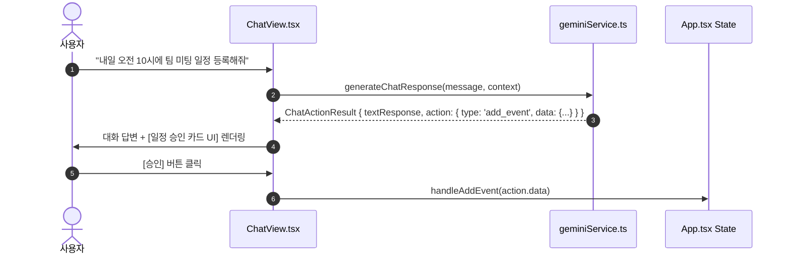

# 🤖 Dayflow AI & Persona Engine

Dayflow의 핵심 동력인 Multi-LLM 연동 체계, 의도 기반 액션 파싱(Intent & Action Parsing), 페르소나 장기 기억 추론(Persona Memory), 서버 사이드 자동화(Edge Functions)에 관한 상세 문서입니다.

---

## 1. Multi-LLM Provider Integration

Dayflow는 특정 클라우드 LLM 서비스에 제한되지 않도록 추상화된 AI 연동 레이어를 제공합니다.

| 서비스 파일 | 대상 프로바이더 | 지원 기능 |
| :--- | :--- | :--- |
| [`geminiService.ts`](file:///C:/Users/%EC%B5%9C%EB%8F%99%EC%A4%80/Desktop/project/dayflow/services/geminiService.ts) | Google Gemini 2.5 / 3.0 | 기본 메인 LLM엔진, 대화 생성, 액션 파싱, 일기 리액션, 라이프 인사이트, 기억 추출 |
| [`openaiService.ts`](file:///C:/Users/%EC%B5%9C%EB%8F%99%EC%A4%80/Desktop/project/dayflow/services/openaiService.ts) | OpenAI GPT-4o 계열 | 텍스트 대화, JSON 구조화 응답 파싱 |
| [`anthropicService.ts`](file:///C:/Users/%EC%B5%9C%EB%8F%99%EC%A4%80/Desktop/project/dayflow/services/anthropicService.ts) | Anthropic Claude 3.5 | 텍스트 대화, JSON 구조화 응답 파싱 |
| [`xaiService.ts`](file:///C:/Users/%EC%B5%9C%EB%8F%99%EC%A4%80/Desktop/project/dayflow/services/xaiService.ts) | xAI Grok | 텍스트 대화, JSON 파싱 |
| [`ollamaService.ts`](file:///C:/Users/%EC%B5%9C%EB%8F%99%EC%A4%80/Desktop/project/dayflow/services/ollamaService.ts) | Local Ollama | 로컬 LLM API 모델 리스트 조회 및 대화 |
| [`localServerService.ts`](file:///C:/Users/%EC%B5%9C%EB%8F%99%EC%A4%80/Desktop/project/dayflow/services/localServerService.ts) | Custom Local Server | LM Studio 등 OpenAI 호환 로컬 엔드포인트 연동 |
| [`trialChatService.ts`](file:///C:/Users/%EC%B5%9C%EB%8F%99%EC%A4%80/Desktop/project/dayflow/services/trialChatService.ts) | Free Trial Proxy | API 키가 없는 사용자를 위한 Supabase Edge Function 프록시 |

---

## 2. Intent & Action Parsing System

사용자가 대화창에서 언급한 의도를 파악하여 앱 내 데이터를 변경하는 액션 카드를 자동으로 반환합니다.

### 액션 파싱 예시 흐름

---

## 3. Persona Memory System (장기 기억 추론)

대화 내역을 바탕으로 사용자에 대한 **관찰 결과(Observation)**를 자동으로 추출하여 `PersonaMemory` 객체로 축적합니다.

### 3가지 메모리 유형
1. **`fact`**: 객관적인 사실 정보 (예: 직업, 거주지, 가족관계 등)
2. **`preference`**: 사용자의 취향 및 선호 스타일 (예: 짧은 답변 선호, 아침 운동 선호 등)
3. **`goal`**: 사용자가 달성하고자 하는 목표 (예: 이번 달 독서 3권 달성 등)

메모리는 관찰 횟수(`observationCount`)와 신뢰도(`confidence`) 지수를 가지며, 중요한 메모리는 사용자가 고정(`pinnedPersonaMemoryIds`)할 수 있습니다.

---
