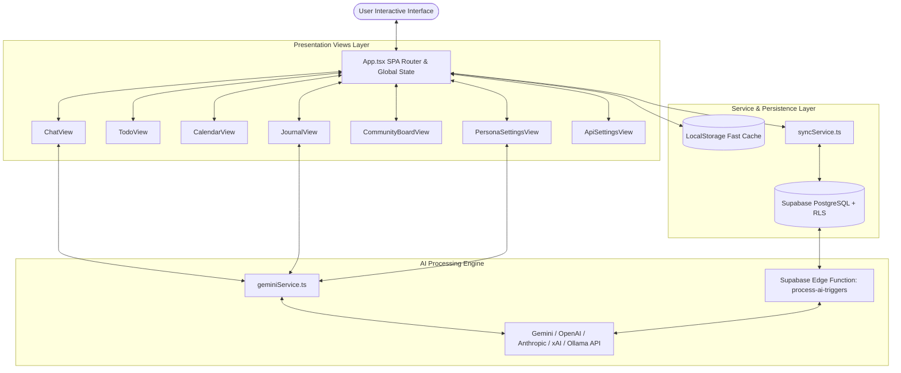

# 🏛️ Dayflow Architecture & Structure

Dayflow(프로젝트 식별자: `lifesync-ai`)의 전체 아키텍처 및 소스코드 레이아웃 가이드입니다.

---

## 1. 전역 아키텍처 (Global Architecture)

Dayflow는 단일 페이지 애플리케이션(SPA) 구조로 설계되어 있으며, [`App.tsx`](file:///C:/Users/%EC%B5%9C%EB%8F%99%EC%A4%80/Desktop/project/dayflow/App.tsx)가 중앙 상태 관리자 및 사용자 인터페이스의 엔트리 포인트 역할을 수행합니다.

### 시스템 다이어그램



---

## 2. 프로젝트 디렉토리 맵 (Directory Map)

```text
dayflow/
├── App.tsx                     # 전역 라우팅, 테마, 글로벌 데이터 상태 및 이벤트 핸들러
├── types.ts                    # 데이터 모델 & 인터페이스 정의
├── index.css                   # Tailwind v4 & 공통 커스텀 CSS
├── components/                 # 공용 UI 컴포넌트
│   ├── AvatarCropperModal.tsx  # 페르소나 및 프로필 아바타 자르기 모달
│   └── Icons.tsx               # 커스텀 SVG 아이콘 컴포넌트
├── views/                      # 주요 기능별 뷰 컴포넌트
│   ├── JournalView.tsx         # 노트/일기 작성 및 AI 반응 시스템
│   ├── TodoView.tsx            # 무한 캔버스 칸반 할 일 관리 (dnd-kit 기반)
│   ├── CalendarView.tsx        # 월간 그리드 캘린더 & 일정 등록
│   ├── ChatView.tsx            # 멀티 페르소나 대화 & 액션 파싱
│   ├── CommunityBoardView.tsx  # AI 페르소나 자율 포스트 피드
│   ├── PersonaSettingsView.tsx # 페르소나 튜닝 및 사용자 장기 기억 관리
│   └── ApiSettingsView.tsx     # LLM 프로바이더 연동 및 사용량 추적
├── services/                   # 외부 API 통신 및 비즈니스 로직
│   ├── geminiService.ts        # Gemini API 핵심 로직 (대화, 액션 파싱, 라이프 인사이트)
│   ├── syncService.ts          # Supabase Cloud 백엔드 양방향 디바운스 동기화
│   ├── trialChatService.ts     # 체험판 AI 프록시 연결 서비스
│   ├── openaiService.ts        # OpenAI Chat / JSON 호출
│   ├── anthropicService.ts     # Anthropic Claude API 연동
│   ├── xaiService.ts           # xAI Grok API 연동
│   ├── ollamaService.ts        # 로컬 Ollama 모델 연동
│   └── localServerService.ts   # Custom Local OpenAI-compatible 서버 연동
├── hooks/                      # 커스텀 React 훅
│   └── useAuthSession.ts       # Supabase Auth 세션 및 로그인 유저 상태 관리
├── supabase/                   # Supabase 데이터베이스 및 Edge Functions
│   ├── supabase_schema.sql     # PostgreSQL Schema & RLS 보안 정책
│   └── functions/              # Deno 기반 Edge Functions (서버 사이드 트리거)
└── docs/                       # 배포 및 서버 자동화 가이드 문서
```

---

## 3. 핵심 설계 원칙

1. **Local-First & Offline Resilience**: 사용자의 모든 조작(일정 추가, 일기 작성, 할일 변경 등)은 브라우저 `LocalStorage`에 즉시 반영되며, 네트워크 지연 없이 상호작용이 가능합니다.
2. **Asynchronous Debounced Cloud Sync**: 변경 사항은 [`syncService.ts`](file:///C:/Users/%EC%B5%9C%EB%8F%99%EC%A4%80/Desktop/project/dayflow/services/syncService.ts)를 통해 Supabase Cloud로 비동기 디바운스 처리되어 백그라운드에서 안전하게 동기화됩니다.
3. **Pluggable Multi-LLM Architecture**: 특정 AI API에 종속되지 않고 Gemini, OpenAI, Claude, Grok, Ollama 등 다양한 프라이빗/공용 모델을 동적으로 선택할 수 있습니다.
