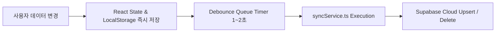

# 💾 Dayflow Data Model & Sync Engine

Dayflow의 데이터 구조([`types.ts`](file:///C:/Users/%EC%B5%9C%EB%8F%99%EC%A4%80/Desktop/project/dayflow/types.ts)), Supabase 데이터베이스 스키마([`supabase_schema.sql`](file:///C:/Users/%EC%B5%9C%EB%8F%99%EC%A4%80/Desktop/project/dayflow/supabase_schema.sql)), 그리고 오프라인 우선 동기화 엔진([`syncService.ts`](file:///C:/Users/%EC%B5%9C%EB%8F%99%EC%A4%80/Desktop/project/dayflow/services/syncService.ts))에 대한 상세 기술 사양입니다.

---

## 1. 핵심 TypeScript 인터페이스

```typescript
// 1. Todo 할 일 항목
export interface Todo {
  id: string;
  text: string;
  completed: boolean;
  date: string;          // ISO date string (YYYY-MM-DD)
  category?: 'work' | 'personal' | 'shopping' | 'health';
  listId?: string;
  stepId?: string;
  startDate?: string;
  dueDate?: string;
  subTasks?: SubTask[];
}

// 2. Journal 일기 항목
export interface JournalEntry {
  id: string;
  title: string;
  content: string;
  date: string;          // ISO date string
  mood: 'good' | 'neutral' | 'bad';
  category?: string;
  comments?: Comment[];  // AI 페르소나 댓글
}

// 3. Calendar 일정
export interface CalendarEvent {
  id: string;
  title: string;
  date: string;          // YYYY-MM-DD
  endDate?: string;
  startTime?: string;    // HH:mm
  endTime?: string;
  isAllDay?: boolean;
  description?: string;
  type: string;          // Tag ID
}

// 4. AI Agent 페르소나
export interface AIAgent {
  id: string;
  name: string;
  emoji: string;
  role: string;
  personality: string;
  tone: string;
  color: string;
  avatar?: string;
  connectionId?: string;
  responseLength?: 'short' | 'medium' | 'long';
}

// 5. Persona Memory
export interface PersonaMemory {
  id: string;
  userId: string;
  agentId: string;
  type: 'fact' | 'preference' | 'goal';
  key: string;
  content: string;
  confidence: number;
  observationCount: number;
}
```

---

## 2. Supabase Cloud DB & RLS Policies

Supabase PostgreSQL 데이터베이스는 완전한 **Row Level Security(RLS)**가 적용되어 있습니다.

| 테이블 명칭 | 저장 데이터 | RLS Policy 접근제안 |
| :--- | :--- | :--- |
| `profiles` | 사용자 기본 프로필 & API 설정 | `auth.uid() = id` |
| `todo_lists` | 할 일 리스트 폴더 | `auth.uid() = user_id` |
| `todos` | 할 일 데이터 항목 | `auth.uid() = user_id` |
| `journal_categories` | 일기 카테고리 | `auth.uid() = user_id` |
| `journal_entries` | 작성된 일기 기록 | `auth.uid() = user_id` |
| `calendar_events` | 캘린더 일정 기록 | `auth.uid() = user_id` |

---

## 3. Dual Persistence & Sync Mechanism

Dayflow는 빠른 사용자 반응을 위해 **LocalStorage Fast-Cache**와 **Debounced Cloud Sync**를 이중으로 구동합니다.



### Sync Service 메서드 가이드
- `syncEvents(userId, events)`: 일정 데이터 델타 동기화
- `syncTodos(userId, todos)`: 투두 항목 동기화
- `syncEntries(userId, entries)`: 일기 동기화
- `syncAgents(userId, agents)`: 페르소나 설정 동기화
- `syncUserData(userId, snapshot)`: 전체 상태 일괄 스냅샷 동기화
